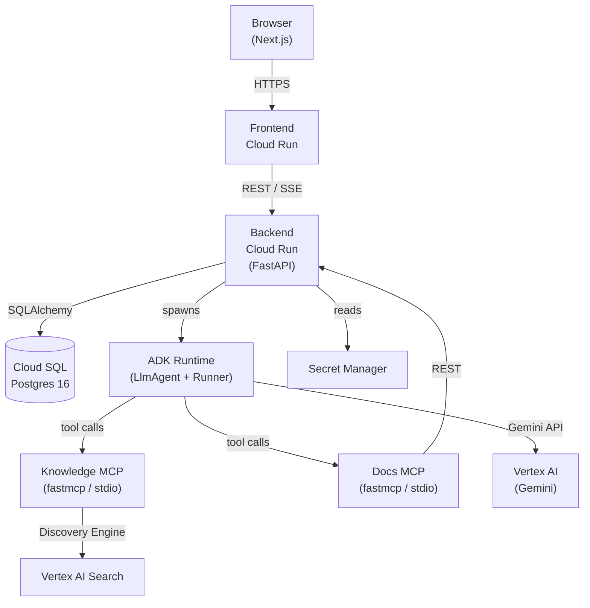
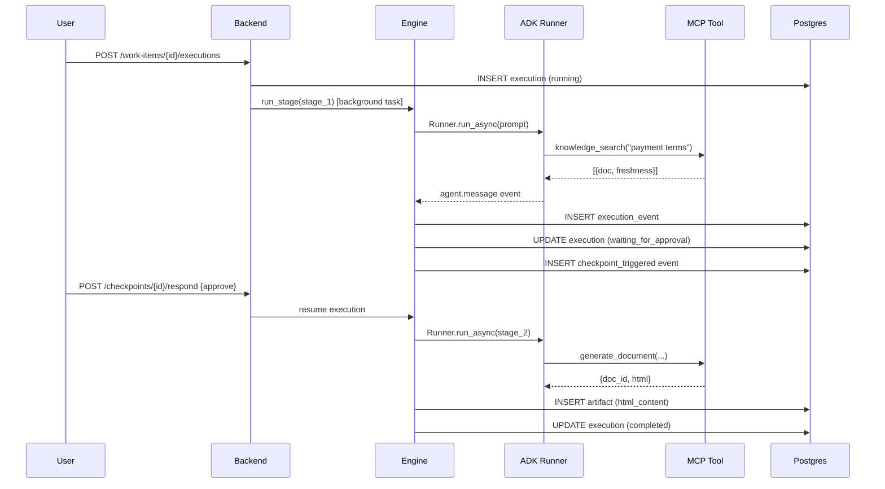
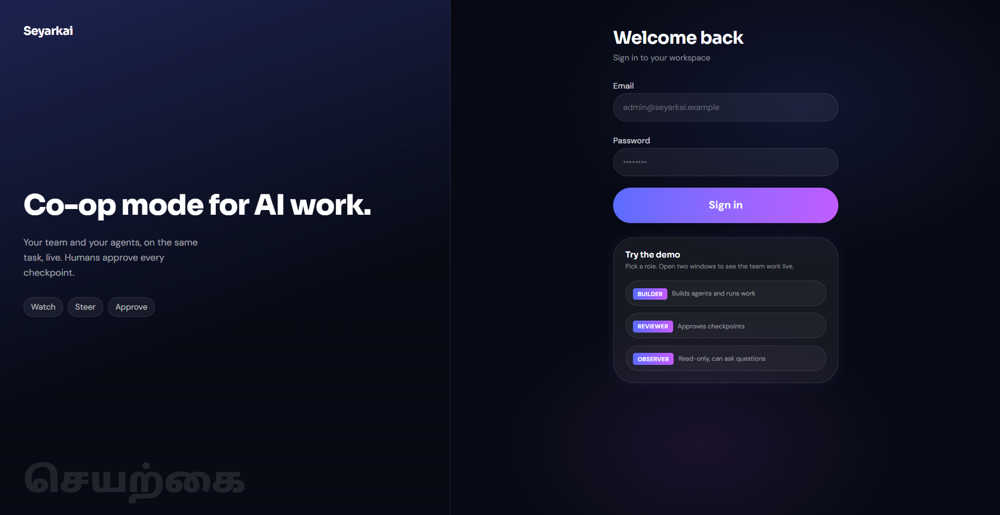
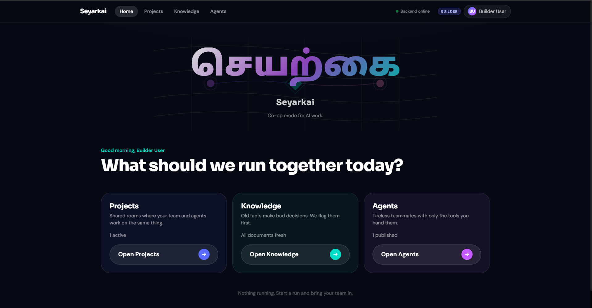
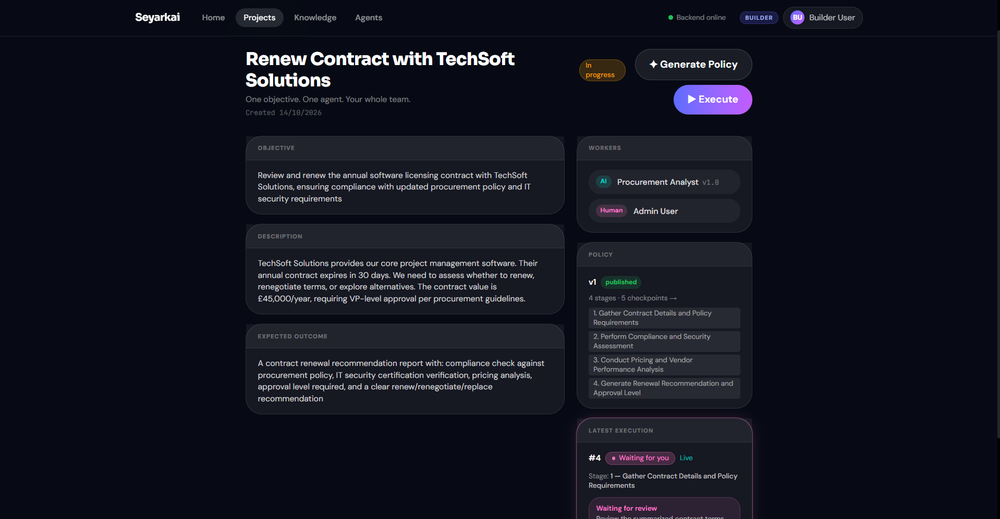
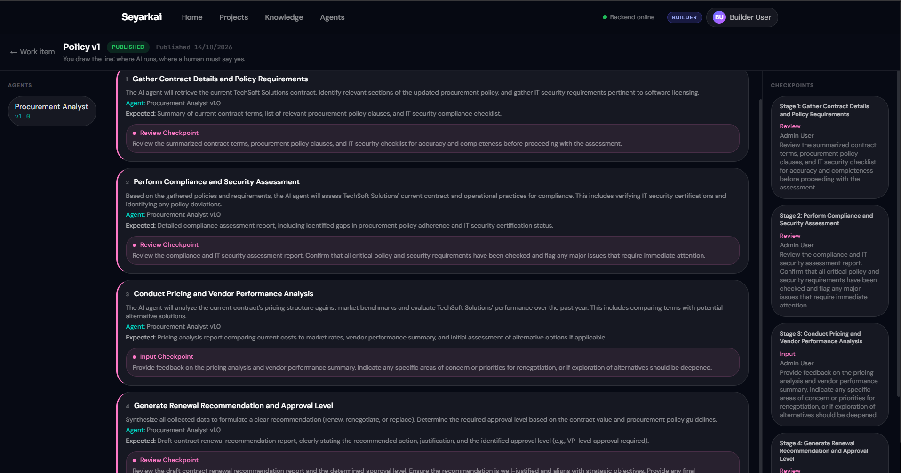
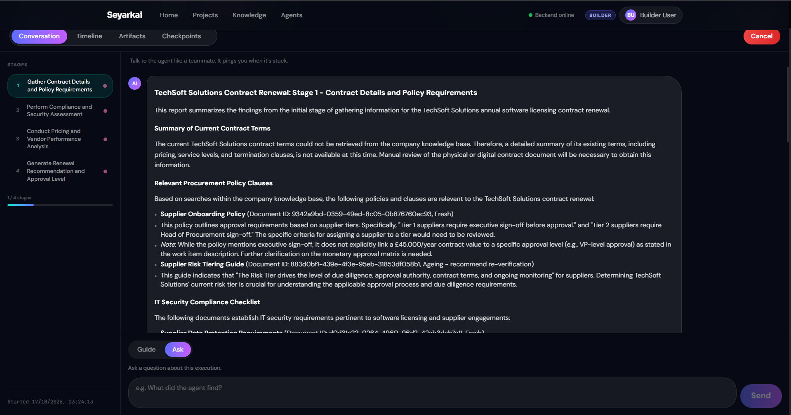
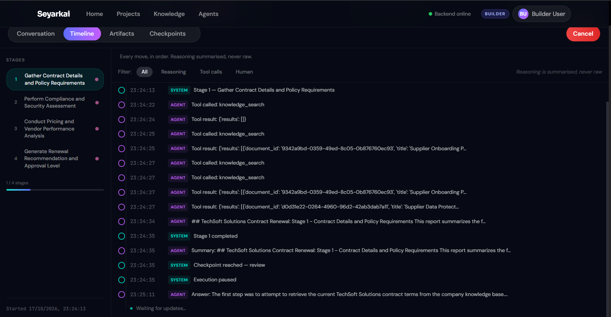
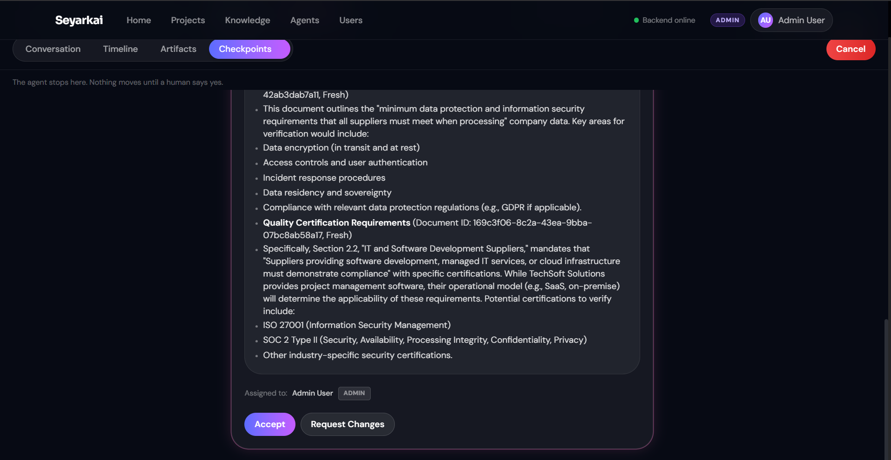

# Seyarkai

**Co-op mode for AI work.**

Seyarkai is a governed execution platform where AI agents and humans work together on multi-stage tasks — with mandatory checkpoints, shared visibility, and role-based controls enforced at every step.

> **சேயற்கை** (*seyarkai*) means "artificial" in Tamil — from *seyal* (to act, to make) + *kai* (hand). Made, not born. The name fits: these agents act, but humans hold the thread.

---

## Live demo

**[https://seyarkai-frontend-7mzqwq6i7q-uc.a.run.app](https://seyarkai-frontend-7mzqwq6i7q-uc.a.run.app)**

### Demo accounts

| Role | Email | Password | Can do |
|---|---|---|---|
| Admin | admin@seyarkai.example | admin123 | Everything, including user management |
| Builder | builder@seyarkai.example | builder123 | Create agents, policies, run work |
| Reviewer | reviewer@seyarkai.example | reviewer123 | Approve checkpoints, launch executions |
| Observer | observer@seyarkai.example | observer123 | Read-only, can ask the agent questions |

### 5-step two-window walkthrough

Open two browser windows side by side — one as Builder, one as Reviewer.

1. **Builder:** Go to *Vendor Onboarding Q4 2026 → Renew Contract with TechSoft Solutions → Execute*. The execution starts and the Conversation tab fills with agent messages in real time.
2. **Reviewer:** Open the same execution. Watch the Conversation tab — the agent is searching the knowledge base and drafting findings.
3. **Reviewer:** When the pink dot appears on the Checkpoints tab, open it. The compliance review is waiting for your approval.
4. **Reviewer:** Click *Approve*. The agent resumes and drafts the renewal recommendation document.
5. **Both:** Switch to the Artifacts tab. The generated document is there, rendered in a sandboxed iframe. The final review checkpoint fires — Reviewer approves to close the work item.

---

## The problem

AI agents can now run multi-step tasks for hours, but the tooling around them was built for a single user. There is no shared view, no way for a team to watch what an agent is doing in real time, no hard stop before a consequential action, and no audit trail that humans can actually read. Teams end up running agents in a black box and finding out what happened after it is too late to steer.

Seyarkai makes AI work a team activity: anyone on the team can join an execution, watch the structured event timeline, send the agent guidance, respond to checkpoints, and see the final artifact — all with roles that determine what each person can do.

---

## What it does

- **Governed execution with mandatory checkpoints.** Policies define stages and checkpoints. The execution engine halts at every checkpoint and cannot proceed until the assigned reviewer responds. Hard stops, not suggestions.
- **Shared execution workspace.** Four tabs — Conversation, Timeline, Artifacts, Checkpoints — update in real time for every participant. No polling required on the client side (server-sent events).
- **LLM-proposed policies, deterministically validated.** The AI generates a policy proposal in JSON. Before anything is saved to the database, a validation layer checks that every stage has a known AI worker, every checkpoint has a known human assignee, and exactly one final-review checkpoint exists. Invalid proposals are rejected with a 422 before they touch the DB.
- **Four roles, enforced server-side.** Admin, Builder, Reviewer, Observer. Every sensitive endpoint is protected by a `require_any` dependency that checks the JWT claim. Frontend permission checks are a UX layer only.
- **Structured event timeline — no raw chain-of-thought.** Agent thought content is stripped at the normalisation layer before any event is persisted or streamed. What you see is what the agent decided, not how it got there.
- **Knowledge retrieval with freshness classification.** Every knowledge document has a `last_verified_at` timestamp. Retrieval results are classified as *fresh* (< 90 days), *ageing* (< 180 days), or *stale* (≥ 180 days), and stale documents carry an explicit warning injected into the agent's context.
- **Document artifacts stored durably in Postgres.** Generated HTML documents are stored in the `artifacts` table and served from the database with `Content-Security-Policy: sandbox` — not from a temp file or Google Drive.

---

## Demo scenario

The pre-seeded scenario is a software contract renewal. The Procurement Agent is tasked with reviewing TechSoft Solutions' contract against company policy before it expires.

1. Builder starts the execution on *Renew Contract with TechSoft Solutions*.
2. **Stage 1 — Compliance Review.** The agent calls `knowledge_search` at least three times, retrieving payment terms, compliance requirements, and approval thresholds. Each result is tagged with its freshness.
3. The mid-stage **Review checkpoint** fires. The reviewer sees the compliance findings and a summary of stale document warnings.
4. Reviewer approves. The agent moves to Stage 2.
5. **Stage 2 — Draft Renewal Recommendation.** The agent calls `generate_document` with the title "TechSoft Solutions Contract Renewal Recommendation". The document covers executive summary, compliance findings, stale flags, and a proceed/escalate decision.
6. The **Final Review checkpoint** fires. The reviewer reads the full document in the Artifacts tab and approves to close the work item.

---

## Architecture





### Google Cloud services used

| Service | Purpose |
|---|---|
| Cloud Run | Hosts backend (FastAPI) and frontend (Next.js) |
| Cloud SQL (Postgres 16) | Primary datastore — all executions, policies, users, artifacts |
| Artifact Registry | Docker image storage (built by Cloud Build) |
| Cloud Build | CI/CD — triggers on push to `main`, builds and pushes images |
| Vertex AI (Gemini) | LLM for policy generation and agent stages (`GOOGLE_GENAI_USE_VERTEXAI=1`) |
| Vertex AI Search | Knowledge retrieval (Discovery Engine data store) |
| Secret Manager | Stores `GEMINI_API_KEY` and DB credentials |
| Google ADK | Agent runtime — `LlmAgent` + `Runner` with `MCPToolset` |
| MCP (fastmcp) | Tool servers for knowledge search and document generation |

---

## Key design decisions

- **LLM proposes; deterministic rules enforce.** The policy generator prompt asks for JSON. `_validate_generation` in `backend/app/policies/router.py` checks every structural constraint before the first DB write. The LLM cannot produce a policy that reaches the database without passing the validator.
- **Events, not chain-of-thought.** `backend/app/runtime/normalise.py` filters out `thought` parts before any event is emitted. Timeline entries describe what happened, not how the model reasoned.
- **MCP tools in isolated subprocesses, granted per agent.** Each agent version has an explicit tool list. The ADK runner spawns the MCP server over stdio only for those tools. An agent cannot call a tool it was not granted.
- **Roles enforced server-side.** Every mutating endpoint uses `require_any("admin", "builder", ...)` as a FastAPI dependency. The frontend `can` checks are a UX convenience only — they do not gate the API.
- **Checkpoints as hard stops.** When the engine reaches a checkpoint, it sets `execution.status = "waiting_for_approval"`, emits a `checkpoint.triggered` event, and the background task exits. The execution does not advance until a human explicitly responds.
- **Durable artifacts in Postgres, rendered in a sandbox.** Generated HTML documents are stored in the `artifacts` table as `html_content TEXT`. The authenticated `/artifacts/{id}` endpoint serves them with `Content-Security-Policy: sandbox` and `X-Content-Type-Options: nosniff` — no filesystem dependency, no Google Drive requirement.

---

## Roles and permissions

| Action | Admin | Builder | Reviewer | Observer |
|---|---|---|---|---|
| Manage users (CRUD) | ✓ | | | |
| Edit agents and agent versions | ✓ | ✓ | | |
| Create / edit projects and work items | ✓ | ✓ | | |
| Create / edit policy stages and checkpoints | ✓ | ✓ | | |
| Generate policy (LLM) | ✓ | ✓ | | |
| Publish policy | ✓ | ✓ | ✓ | |
| Launch executions | ✓ | ✓ | ✓ | |
| Respond to checkpoints | ✓ | ✓ | ✓ | |
| Add / verify knowledge documents | ✓ | ✓ | ✓ | |
| Send guidance messages | ✓ | ✓ | ✓ | |
| Read everything (list / get) | ✓ | ✓ | ✓ | ✓ |

---

## Tech stack

**Backend**
- Python 3.11, FastAPI 0.141.1
- SQLAlchemy 2.0.36 (asyncio) + asyncpg 0.29.0, Alembic 1.13.3
- google-adk 2.11.0, google-genai 2.28.0, fastmcp 4.0.10
- google-cloud-discoveryengine 0.20.5 (Vertex AI Search)
- PyJWT 2.15.1, bcrypt 5.0.0
- sse-starlette 3.5.0, pytest 8.3.3, httpx 0.28.1

**Frontend**
- Next.js 16.3.8, React 19.2.8, TypeScript 5
- Tailwind CSS 4, shadcn/ui, lucide-react, Framer Motion 14

---

## Run locally

### Prerequisites

- Python 3.11+
- Node.js 20+
- PostgreSQL 16 running locally
- Google Cloud credentials configured (`gcloud auth application-default login`) if using Vertex AI

### Setup

```bash
git clone https://github.com/Guruprasad712/seyarkai_workspace.git
cd seyarkai_workspace
```

**Backend:**
```bash
cd backend
python -m venv .venv
source .venv/bin/activate        # Windows: .venv\Scripts\activate
pip install -r requirements.txt
cp ../.env.example ../.env
# Edit .env — set DATABASE_URL, JWT_SECRET, and Google Cloud vars
```

Verify the database is local before running any DB command:
```bash
python -c "import os; url=os.getenv('DATABASE_URL',''); assert 'localhost' in url or '127.0.0.1' in url, 'Not localhost!'; print('OK:', url)"
```

```bash
python -m alembic upgrade head
python -m scripts.seed_users        # requires SEED_*_PASSWORD vars in .env
python -m scripts.seed_techsoft     # seeds the TechSoft demo scenario
uvicorn app.main:app --reload --port 8000
```

**Frontend:**
```bash
cd frontend
npm install
# Set NEXT_PUBLIC_API_URL=http://localhost:8000 in .env (copy from .env.example)
npm run dev
```

Open [http://localhost:3000](http://localhost:3000).

---

## Deployment

Cloud Build triggers automatically on every push to `main`. The pipeline has four steps:

1. Build the backend Docker image
2. Build the frontend Docker image (with `NEXT_PUBLIC_API_URL` baked in as a build arg)
3. Push backend image to Artifact Registry
4. Push frontend image to Artifact Registry

**Cloud Build does not run `alembic upgrade head` and does not deploy to Cloud Run.** Migrations must be run manually against the production database (via Cloud SQL Auth Proxy) before or after each release. Cloud Run services are updated manually using the scripts in `deploy/`.

---

## Testing

```bash
cd backend
python -m pytest tests/ -x -q
```

**231 tests across 22 test files.** Covers auth, RBAC, agents, policies, projects, work items, executions, engine, checkpoint responses, knowledge, artifacts, MCP servers, event normalisation, and agent routing.

Gemini is never called in CI. Stage execution is mocked in tests via `@pytest.mark.live` separation.

---

## Limitations

These are known gaps accepted for the hackathon scope. See `docs/KNOWN_LIMITATIONS.md` for the full list.

- **JWT in localStorage.** Tokens should be HttpOnly cookies. Current approach is vulnerable to XSS.
- **Single Cloud Run instance.** Background executions run in-process. If the instance restarts mid-execution, in-flight work is lost — there is no durable task queue.
- **Single tenant.** No workspace isolation between users. All users see all projects.
- **No admin UI for user management.** Users can only be created via the `seed_users.py` script.
- **Human participation only at checkpoints.** Policy stages are all AI tasks. There is no human-task stage type — humans participate only by approving or rejecting checkpoints.
- **Knowledge freshness is age-based only.** `last_verified_at` is the only signal. There is no content-change detection.
- **Guidance messages are queued, not injected live.** A message sent mid-stage is queued and picked up at the next stage. The ADK runner does not support mid-turn user turns.
- **HTML artifact fallback.** When the Docs service account is not configured, `generate_document` produces an HTML artifact stored in Postgres rather than a Google Doc. The demo uses this path.
- **MCP tool startup latency on cold starts.** Each MCP server is a subprocess spawned per stage. On Cloud Run cold starts, the first tool call may be slow.

---

## Roadmap

- Durable background task queue (Cloud Tasks or Pub/Sub) so executions survive instance restarts
- Real-time presence indicators — show who else is watching an execution
- Human-task stage type — assign a policy stage to a person, not just an AI agent
- HttpOnly cookie auth + PKCE-based OAuth login
- Multi-workspace isolation

---

## Repository layout

```
seyarkai_workspace/
├── backend/
│   ├── app/
│   │   ├── agents/        # agent CRUD and version management
│   │   ├── auth/          # JWT auth, users router, RBAC dependencies
│   │   ├── core/          # config, DB session, error types
│   │   ├── executions/    # engine, events, checkpoints, SSE, artifacts
│   │   ├── knowledge/     # documents, retrievers, freshness
│   │   ├── mcp_servers/   # knowledge/ and docs/ FastMCP tool servers
│   │   ├── policies/      # policy CRUD, generation, validation, publish
│   │   ├── projects/      # project CRUD
│   │   ├── runtime/       # ADK agent building, stage runner, event normalisation
│   │   └── work_items/    # work item CRUD, worker assignment
│   ├── alembic/           # migrations (0001–0005)
│   ├── scripts/           # seed_users.py, seed_techsoft.py
│   └── tests/             # 231 tests across 22 files
├── frontend/
│   ├── app/               # Next.js App Router pages
│   ├── components/        # shared UI components
│   └── lib/               # api client, auth helpers, permissions, types
├── deploy/                # Cloud Run deploy scripts, cloudbuild.yaml
├── docs/                  # ARCHITECTURE.md, CONTRACTS.md, KNOWN_LIMITATIONS.md
│   └── screenshots/       # add PNG screenshots here (see screenshots/README.md)
├── .env.example           # template — copy to .env and fill in
└── cloudbuild.yaml        # CI pipeline (build + push images only)
```

---

## Screenshots

> Add the PNG files listed in [`docs/screenshots/README.md`](docs/screenshots/README.md) to complete this gallery. The filenames below are placeholders — images must be added manually.

| | | |
|---|---|---|
|  |  |  |
| *Login with demo access card* | *Home dashboard* | *Project with work items* |
|  |  |  |
| *Work item detail* | *Policy editor* | *Execution — Conversation tab* |
|  |  |  |
| *Execution — Timeline tab* | *Execution — Checkpoints tab* | *Execution — Artifacts tab* |

---

## Credits and license

Built by **Guruprasad P** for the Google Cloud AI Builders Cup hackathon.

License: MIT — see [`LICENSE`](LICENSE).
